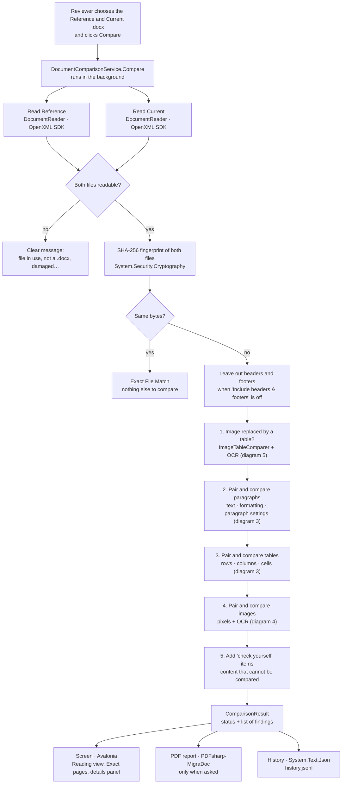
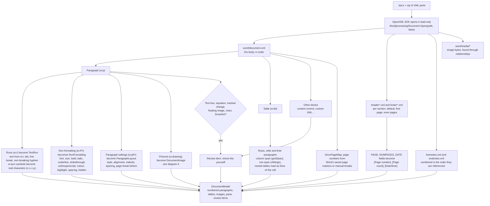
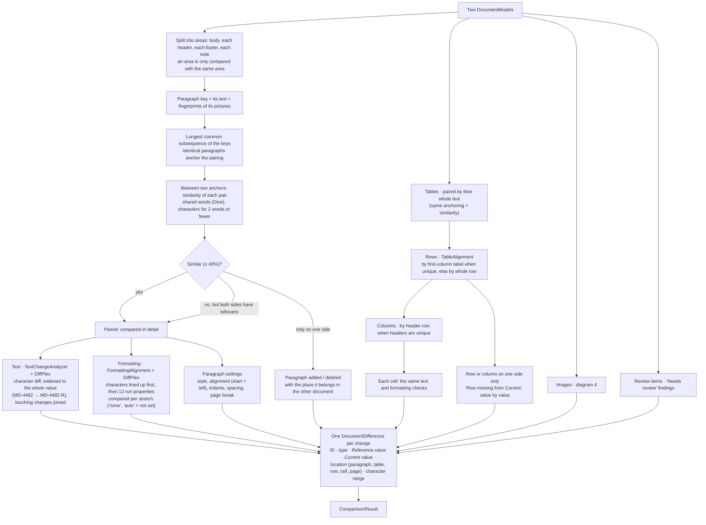
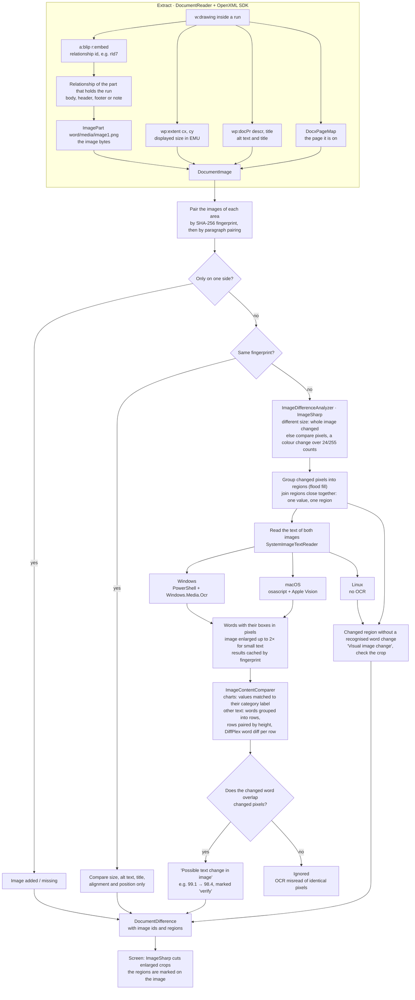
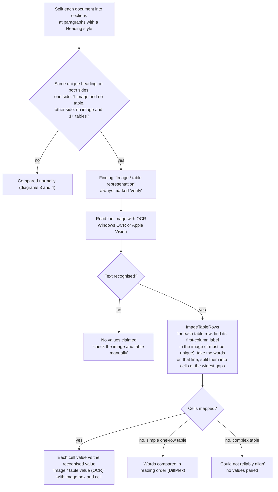
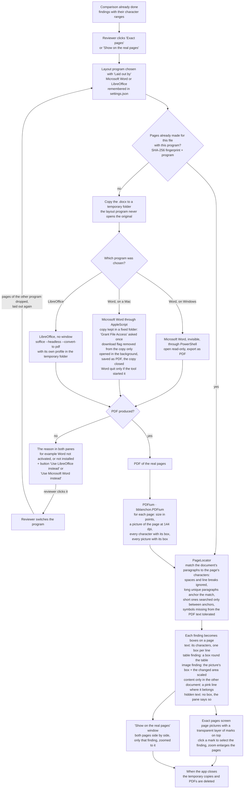
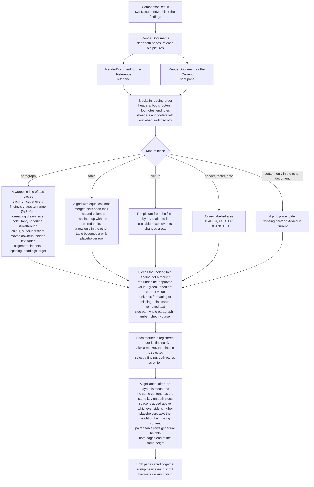

# How Document Checker finds differences

Seven flow diagrams, from the click on **Compare** to the screen, with the package or component that does each step. The diagrams use [Mermaid](https://mermaid.js.org); GitHub and GitLab draw them, and VS Code does with a Mermaid preview extension.

| Package / component | Used in |
|---|---|
| **DocumentFormat.OpenXml** 3.5.1 | Reading the `.docx` (diagram 2, images in diagram 4) |
| **DiffPlex** 1.9.0 | Text and formatting differences (diagram 3), words in images (diagrams 4 and 5) |
| **SixLabors.ImageSharp** 2.1.13 | Pixel comparison, enlarging images for OCR, crops (diagram 4) |
| **Windows OCR** / **Apple Vision** | Reading text in images (diagrams 4 and 5) |
| **System.Security.Cryptography** (SHA-256) | Exact File Match, pairing images, history |
| **Avalonia** 12.1.3 | The screen, including drawing Reading view (diagram 7) |
| **Microsoft Word** or **LibreOffice** (the reviewer's choice) | Laying out the real pages for Exact pages (diagram 6) |
| **PDFium** (bblanchon.PDFium 156.0.8066) | Page pictures and character positions for Exact pages (diagram 6) |
| **PDFsharp-MigraDoc** 6.2.4 | The PDF report |
| **System.Text.Json** | History, OCR results |

## 1. The whole flow

## 2. Reading a .docx

A `.docx` is a zip file of XML parts. The OpenXML SDK opens it read-only and the reader turns each part into a clean model.

## 3. Identifying the differences

Everything is paired first, so that one inserted line does not make every line after it look changed. Each pair is then compared in detail.

The **character range** of each finding (paragraph, first character, length) is what lets the screen underline exactly the changed value, and Exact pages box it on the real page.

## 4. Extracting and comparing images

## 5. An image replaced by a table

## 6. Exact pages: marking the differences on the real pages

Exact pages does not find differences. It takes the findings already made from the `.docx` (diagram 3) and marks them on the pages as Word or LibreOffice lays them out. The reviewer chooses the program with the **Laid out by: Microsoft Word | LibreOffice** switch; the tool uses exactly that program and never swaps it silently.

## 7. Reading view: drawing the two documents side by side

Reading view does not show a picture of the Word file. It draws each document from the same data that was compared (the `DocumentModel`), so every highlight lands on exactly the characters of a finding. It is a clean reading layout, not Word's page layout (for that, see diagram 6).

