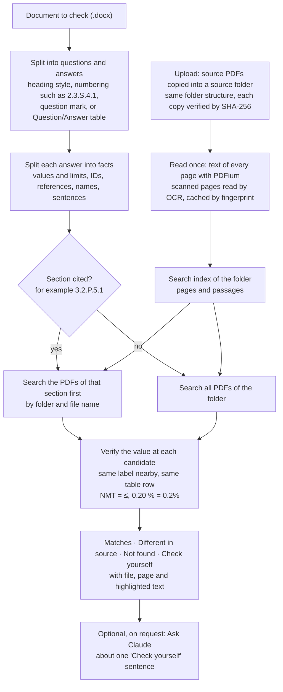

# Source check — plan

| Item | Value |
|---|---|
| **Status** | Phases 2–5 built (source folders, questions and facts, checking, Source check window). Next: history and PDF report, Ask Claude, tuning on real documents |
| **Date** | 2026-10-13 |
| **Requirement** | FR-20 in [REQUIREMENTS.md](REQUIREMENTS.md) |

## What it does

The document to check (**Current**) is a question-based document (for example a QbR Quality Overall Summary): questions, each followed by its answer. **Source check** takes every answer, finds where that information comes from in the **source PDFs**, and checks that each value and statement in the answer matches the source. Each finding shows its evidence: the source file, the page, and the matching text highlighted on the page.

| Result | Meaning |
|---|---|
| ✅ **Matches source** | The same value was found in a source PDF, in the same context (file and page shown) |
| ❌ **Different in source** | The place was found, but the source has another value (answer "NMT 0.2%", source "NMT 0.15%") |
| ⚠️ **Not found in sources** | No source PDF contains this fact |
| 🔍 **Check yourself** | Several candidates, or a sentence without values: the best passage is shown for the reviewer to confirm |

## Decisions

| Question | Decision |
|---|---|
| Source file types | **PDF only.** Text PDFs are read with PDFium (already in the tool). Scanned pages (no text layer) are read with the computer's own text recognition (Windows OCR / Apple Vision, already in the tool). Other files in an uploaded folder are listed as skipped. |
| The document to check | A question-and-answer document (`.docx`), read with the existing reader |
| Local or cloud | **Local first.** Every result is produced on this computer. **Claude may be used in a limited way** (see "Use of Claude") |
| Users | **One person on one computer.** Source folders are kept in the user's application-data folder; no server, no sharing |

## How the check works (recommended approach)

Facts are extracted from the answers, candidate passages are found with a local search index, and each value is verified at the spot it was found. AI alone is not used for the verdict, for three reasons:

1. **Confidentiality.** Document content stays on the computer unless the reviewer sends a specific passage to Claude.
2. **Audit.** In a regulated review every "Matches" must point to an exact file, page and text, which this approach always gives.
3. **Repeatability.** The same files always give the same result.



| Fact type | Example | How it is checked |
|---|---|---|
| Values, units and limits | `NMT 0.2%`, `95.0–105.0%`, `25 °C/60% RH`, `24 months` | Found next to the same label in the source (for example the same test name in the same table row). "NMT", "Not more than" and "≤" are equal; "0.20 %" equals "0.2%"; ranges are compared at both ends |
| Identifiers | batch or lot numbers, document IDs, method numbers (`AM-101`) | Exact match |
| References | "see 3.2.P.5.1" | Narrows the search to the PDFs of that section (folder and file names) |
| Names | manufacturer, site, product, excipients | Exact match, or close match with a warning |
| Sentences without values | "The process is validated…" | Best passage shown, 🔍 Check yourself |

## Source folders (upload)

- **New source folder:** the reviewer names it; the tool creates it.
- **Upload folder:** copies the chosen folder with all its subfolders into the source folder, keeping the same structure (the chosen folder's own name is the top level, as when a folder is dragged into a drive). Uploading the same folder again brings the copy up to date: new and changed PDFs are copied, unchanged ones kept, and PDFs no longer in the original folder are removed from the copy (the originals are never touched).
- **Add PDF files:** adds single PDFs at the top level.
- **Every copy is verified:** the SHA-256 fingerprint of the copy must equal the original's; the result says, for example, "142 of 142 PDF files uploaded correctly". Files that are not PDFs are listed as skipped; PDFs that cannot be read (password-protected, damaged) are listed with the reason.
- **Read once:** the text of each page is read at upload and cached by fingerprint, so checking is fast.
- **Stored** in `DocumentChecker/Sources/<folder name>/` next to the history: `library.json` (each file with its path, size, fingerprint, pages, how its text was read), `files/` (the copies) and `text/` (the page text).

## Screen flow

```
[ Compare two documents ]  [ Check against sources ]      ← mode switch

② Document to check: QOS-Examplin.docx              [Choose…]
③ Source folder:     Examplin 250 mg – Module 3 ▾   [Source folders…]
                                                  [ Proceed checking ]
```

Then: progress ("Question 12 of 48…"); results by question ("✅ 31 ❌ 2 ⚠️ 3 🔍 5"); clicking a fact opens the answer and the source page side by side with both highlighted; filters, **Next to review**, PDF report with file and page for every fact, and an entry in the history.

## Use of Claude (limited, optional)

- **Off by default.** Switched on in settings with an API key, kept in the system keychain (macOS Keychain, Windows Credential Manager).
- **Only on request, one fact at a time:** an **Ask Claude** button on a 🔍 Check yourself or ⚠️ Not found item.
- **Only small passages are sent:** the answer sentence and at most three source passages (about 2,000 characters in all), never whole documents. The reviewer sees exactly what will be sent before it is sent.
- **Claude suggests, the reviewer decides:** the reply must quote the source text it relies on; the tool checks that the quote really is in the source PDF, then shows the suggestion. The verdict stays the reviewer's.
- **Recorded:** what was sent and the reply are kept with the check in the history.
- Model: Claude Sonnet 5.5 (`claude-sonnet-5-5`); Claude Haiku 5.5 (`claude-haiku-5-5`) as a cheaper choice.

## Phases

| Phase | Content | Needs |
|---|---|---|
| 1 | Agree the format: the layout was taken from a QbR QOS screenshot (numbered questions in shaded boxes, label/value answer tables); still to confirm on real documents and source PDFs | From Amneal |
| 2 | **Source folders:** create, upload with the same structure, verify, read text (OCR for scanned pages), list problems, delete | ✅ Built |
| 3 | Questions, answers and facts from the document to check | ✅ Built |
| 4 | Search and verify engine with the four results and evidence | ✅ Built |
| 5 | Source check window with evidence pages, filters, Next to review, CSV export | ✅ Built. History and PDF report still to do |
| 6 | Ask Claude (optional) | Approval and API key |
| 7 | Tune the rules on real QOS documents and their sources (labels written differently, tables split over pages, scanned sources) | Real documents |

Each phase adds requirements (FR-20.x) and test cases (TC-SRC-xx), with synthetic sources generated by the tests.
